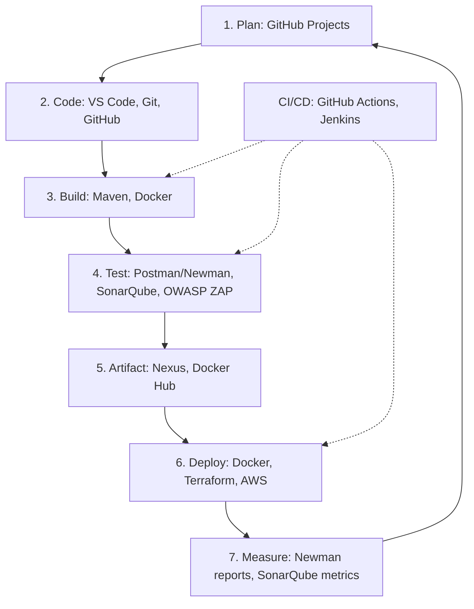

# BÁO CÁO LAB 2 — DEVOPS VÀ CALMS

- Họ tên: Đặng Đức Mạnh
- MSSV: DTC235180119
- Lớp: KTPM K22C

## 1. Kiểm tra môi trường

- VS Code: 1.142.0
- Git: 2.56.0.windows.2
- Docker: 29.8.2
- Docker Compose: v5.6.0
- Docker Engine chạy Linux container qua WSL2.

## 2. Automation

Giải pháp: Viết script setup-dev-env.ps1 để tự động tạo thư mục
screenshots và các file package.json, server.js, Dockerfile,
.dockerignore.

Thành viên mới lấy mã nguồn, chạy script rồi build và chạy Docker,
giúp giảm thao tác thủ công và hạn chế sai sót khi thiết lập môi trường.

Lệnh chạy:

    powershell -NoProfile -ExecutionPolicy Bypass -File .\setup-dev-env.ps1

Kết quả: Script chạy thành công và tạo đủ các file cần thiết.

## 3. Lean — Docker

Đã build image devops-lab2-app và chạy container lab2-app.

Các lệnh thực hiện:

    docker build -t devops-lab2-app .
    docker run -d -p 3000:3000 --name lab2-app devops-lab2-app
    docker ps
    curl.exe http://localhost:3000

Kết quả trả về:
- message: Hello from Docker!
- node_version: v18.20.8
- platform: linux

Docker đóng gói ứng dụng cùng môi trường Node.js, giúp giảm khác biệt
môi trường giữa các máy.

Khi chia sẻ image cho người khác, nếu máy họ có Docker tương thích
và cổng sử dụng còn trống, họ có thể chạy cùng ứng dụng và nhận
JSON tương tự. Timestamp thay đổi theo thời điểm gửi yêu cầu.

## 4. DevOps Toolchain Map

Sơ đồ mô tả toàn bộ toolchain của môn học; không có nghĩa là tất cả
công cụ trên đã được thực hành trong Lab 2.

## 5. Bảng công cụ

| Giai đoạn | Công cụ | Lab theo tài liệu | Mục đích |
|---|---|---|---|
| Plan | GitHub Projects | — | Quản lý công việc |
| Code | Git, GitHub | 1, 5 | Quản lý và chia sẻ mã nguồn |
| Code | VS Code | 2 | Soạn thảo mã nguồn |
| Build | Maven | 7 | Build dự án Java |
| Test | Postman/Newman | 6 | Kiểm thử API |
| Test | SonarQube | 6, 7 | Phân tích chất lượng mã nguồn |
| Test | OWASP ZAP | 6 | Kiểm thử bảo mật |
| Deploy | Docker | 2, 7, 8 | Đóng gói và chạy ứng dụng |
| Deploy | Terraform | 3 | Khai báo hạ tầng bằng mã |
| Deploy | AWS | 3 | Cung cấp hạ tầng cloud |
| CI/CD | GitHub Actions | 1 | Tự động hóa pipeline |
| CI/CD | Jenkins | 7 | Điều phối pipeline |
| Artifact | Nexus | 7 | Lưu trữ artifact |

## 6. CALMS trong Lab 2

| Nguyên tắc | Hoạt động áp dụng |
|---|---|
| Culture | Chuẩn hóa cách thiết lập để các thành viên dễ phối hợp |
| Automation | Chạy script tự động tạo cấu trúc và file dự án |
| Lean | Dùng Docker để giảm thao tác cài môi trường thủ công |
| Measurement | Kiểm tra trạng thái container bằng docker ps và phản hồi HTTP bằng curl |
| Sharing | Ghi lại hướng dẫn, sơ đồ toolchain và chia sẻ mã nguồn/script |

## 7. Tự đánh giá CALMS

| Nguyên tắc | Điểm /5 | Giải thích |
|---|---|---|
| Culture | 2 | Có ý thức chuẩn hóa môi trường làm việc, nhưng chưa có nhiều trải nghiệm phối hợp giữa Dev và Ops. |
| Automation | 3 | Đã chạy script tự động tạo cấu trúc và các file dự án; thao tác build và chạy Docker vẫn thực hiện thủ công. |
| Lean | 3 | Đã sử dụng Docker để chạy ứng dụng trong môi trường nhất quán, giảm việc cài đặt Node.js trực tiếp trên từng máy. |
| Measurement | 2 | Đã kiểm tra trạng thái container bằng `docker ps` và phản hồi ứng dụng bằng `curl`; chưa có hệ thống giám sát liên tục. |
| Sharing | 2 | Đã chuẩn bị tài liệu báo cáo và hướng dẫn chạy ứng dụng; chưa thực hiện code review hoặc chia sẻ thường xuyên trong nhóm. |
| **Tổng** | **12/25** | Đã thực hành DevOps ở mức cơ bản, cần cải thiện tự động hóa, giám sát và cộng tác. |

## 8. Ba hành động cải thiện

1. Bổ sung kiểm thử tự động vào pipeline để kiểm tra ứng dụng khi cập nhật mã nguồn.
2. Chuẩn hóa hướng dẫn chạy dự án bằng Docker để thành viên mới dễ bắt đầu.
3. Theo dõi thời gian build và số lần build thành công/thất bại để tìm điểm cần cải thiện.